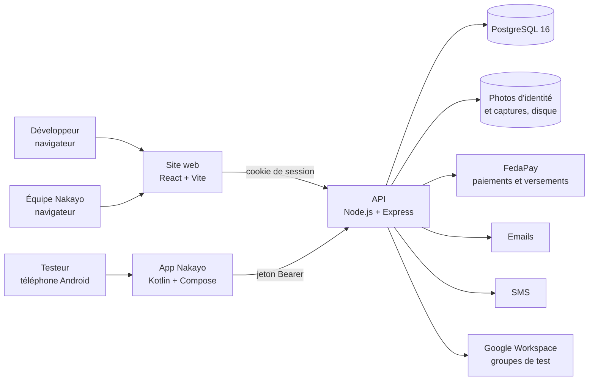
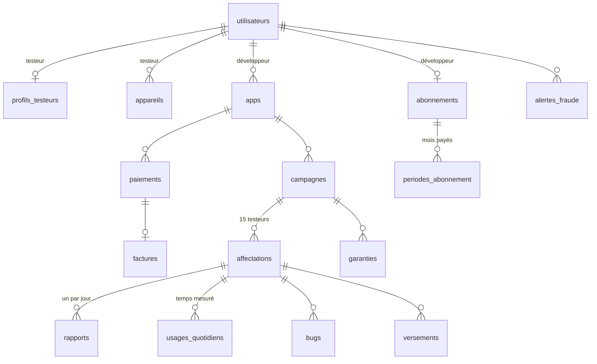

# Architecture de Nakayo (US-02)

Vue d'ensemble pour qui arrive sur le projet. Le détail de chaque fonction est dans les autres fichiers de `docs/`.

## Les trois applications

- **Site web** (`client/`) : espace développeur (apps, paiements, abonnement, suivi de campagne, rapport final) et espace admin (comptes, apps, campagnes, fraude, garanties, tableau de bord). Les testeurs n'ont pas d'espace sur le site.
- **App Android** (`android/`) : inscription du testeur avec photos, campagnes affectées, rapport quotidien, bugs, portefeuille. Le module `noyau` contient la logique sans Android (modèles, appels à l'API) ; `app` contient les écrans et les accès Android (statistiques d'usage, position, intégrité).
- **API** (`server/`) : seule à parler à la base et aux services externes.

## Organisation de l'API

| Dossier | Rôle |
|---|---|
| `src/routes/` | une fonction `routesX(deps)` par domaine, montée dans `app.js` sous `/api/...` |
| `src/services/` | règles métier et requêtes SQL, testables sans HTTP |
| `src/lib/` | fonctions pures : offres et prix, validation, dates au fuseau du Bénin, PDF |
| `src/middlewares/` | session, rôles, limites de requêtes, erreurs |
| `migrations/` | scripts SQL appliqués dans l'ordre de leur numéro |

Les dépendances (base, emails, SMS, FedaPay, horloge) sont injectées par `deps` : les tests les remplacent par des doubles (`creerAppTest`) et avancent l'horloge.

## Tâches planifiées

Lancées par `server/src/index.js` :

- **passage de nuit** (`verificationQuotidienne.js`) : jours validés, fraude, remplacement des inactifs, rapports finaux, emails d'étape, rappels d'abonnement ;
- **versements** (`versements.js`) : paiement des testeurs par Mobile Money à la clôture ;
- **rappels du soir** (`rappelsSoir.js`) : SMS à 22 h quand un rapport manque ;
- **groupes Google** (`googleGroupes.js`) : synchronisation des testeurs avec le groupe de test de chaque app.

## Modèle de données

Tables principales :

- **Comptes** : `utilisateurs` (rôle développeur, testeur ou admin ; statut), `profils_testeurs`, `appareils`, `documents_identite`, `controles_comptes`, `decisions_comptes`, `blocages`, `journal_admin`.
- **Apps et paiements** : `apps`, `decisions_apps`, `paiements`, `factures`, `devis` (Offre Plus), `abonnements`, `periodes_abonnement`.
- **Campagnes** : `campagnes`, `affectations`, `rapports`, `usages_quotidiens`, `verifications_quotidiennes`, `bugs`, `retours_terrain`, `versions_campagne`, `garanties`.
- **Testeurs payés** : `versements`, parrainage dans `profils_testeurs`.
- **Fraude** : `alertes_fraude`, `reseaux_testeurs` (empreinte du Wi-Fi).

## Paiements

- **Développeurs** : FedaPay, qui encaisse en FCFA par Mobile Money ou par carte (docs/fedapay.md). En local et en test, une page de simulation remplace FedaPay (`PAIEMENT_MODE=simulation`).
- **Testeurs** : versements Mobile Money par FedaPay.
- **Carte en dollars et prélèvement automatique** : pas encore branchés. Il faut d'abord un compte Paddle, Lemon Squeezy ou Stripe (docs/abonnement.md).

## Secrets et configuration

Toutes les clés (FedaPay, secret des webhooks, Google, base) sont lues dans les variables d'environnement par `server/src/config.js`. Le fichier `server/.env` n'est jamais commité ; `server/.env.example` liste les variables sans leurs valeurs.

## Tests et intégration continue

- API : vitest + supertest sur une vraie base PostgreSQL.
- Site : vitest + Testing Library avec l'API simulée, et des tests de bout en bout contre la vraie API.
- Android : tests unitaires (`noyau`, `app`), lint, tests instrumentés sur émulateur.
- La CI (`.github/workflows/ci.yml`) lance ce qui correspond aux dossiers modifiés ; `workflow.yml` vérifie le nom de la branche.
